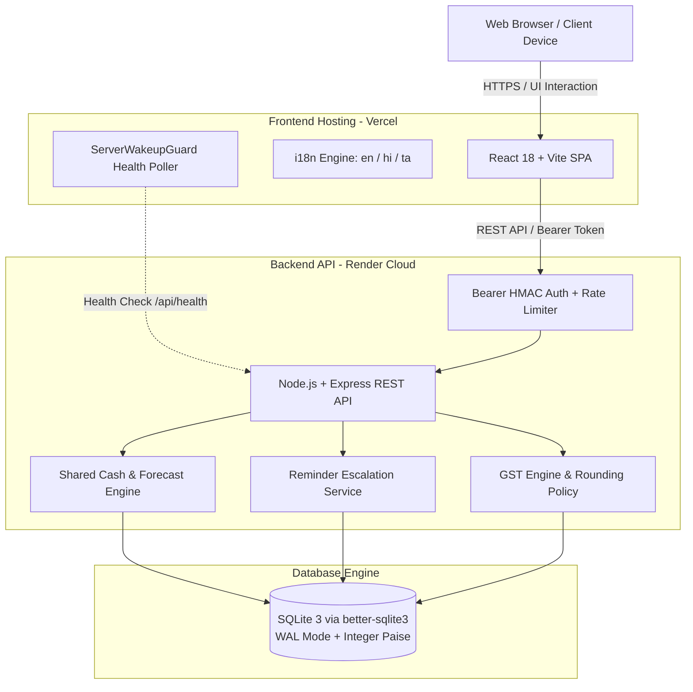

# Baaki (बाकी) - Smart Receivables & Cash Flow Assistant for Small Businesses

> **Never let overdue invoices choke your business.** A proactive, GST-compliant receivables and cash flow management platform designed specifically for Indian MSMEs, manufacturers, and traders.

---

## 📸 Application Screenshots (Desktop 1280px & Mobile 360px)

Every view in Baaki is tested against both desktop (1280px) and mobile phone (360px) viewports with strict accessibility standards (zero horizontal overflow, 48px+ touch targets, and status always shown with text + color, never color alone).

| Screen | Desktop View (1280px) | Mobile View (360px) |
|---|---|---|
| **Executive Dashboard** | [dashboard_1280.png](docs/screenshots/dashboard_1280.png) | [dashboard_360.png](docs/screenshots/dashboard_360.png) |
| **Chase-First Priority** | [chase_first_1280.png](docs/screenshots/chase_first_1280.png) | [chase_first_360.png](docs/screenshots/chase_first_360.png) |
| **Today's Follow-ups** | [followups_1280.png](docs/screenshots/followups_1280.png) | [followups_360.png](docs/screenshots/followups_360.png) |
| **13-Week Cash Forecast** | [forecast_1280.png](docs/screenshots/forecast_1280.png) | [forecast_360.png](docs/screenshots/forecast_360.png) |
| **Public Pay Portal** | [pay_page_1280.png](docs/screenshots/pay_page_1280.png) | [pay_page_360.png](docs/screenshots/pay_page_360.png) |
| **Merchant Inbox** | [inbox_1280.png](docs/screenshots/inbox_1280.png) | [inbox_360.png](docs/screenshots/inbox_360.png) |
| **Invoice Ledger & Detail** | [invoice_1280.png](docs/screenshots/invoice_1280.png) | [invoice_360.png](docs/screenshots/invoice_360.png) |
| **Demand Letter Preview** | [demand_letter_print_1280.png](docs/screenshots/demand_letter_print_1280.png) | [demand_letter_print_360.png](docs/screenshots/demand_letter_print_360.png) |

---

## 🌐 Live Deployment & Links

| Service | Platform | URL | Status |
|---|---|---|---|
| **Frontend Web App** | Vercel | `https://baaki-receivables.vercel.app` | Configurable / Live |
| **Backend REST API** | Render | `https://smart-receivables-cash-flow.onrender.com` | Live |
| **API Health Check** | Render | `https://smart-receivables-cash-flow.onrender.com/api/health` | Live (`200 OK`) |
| **Product Walkthrough Video** | YouTube | `https://youtu.be/placeholder-demo` | Demo Video Link |

---

## 📌 Problem & Solution

### The MSME Problem
Indian small and medium enterprises (MSMEs) operate on razor-thin cash flow margins. While Section 43B(h) of the Income Tax Act mandates 45-day settlement for MSME dues, business owners face recurring working capital bottlenecks:
1. **Blindspot Shortfalls**: Business owners rarely know when a cash deficit will occur until their bank account is depleted and cheques bounce.
2. **Awkward & Ineffective Chasing**: Manual phone calls or haphazard WhatsApp messages strain customer relationships and lack disciplined escalation.
3. **Complex Indian GST & TDS Realities**: Reconciling payments with 1%, 2%, or 10% TDS deductions (Section 194C/J) creates administrative chaos and unapplied balances.
4. **Dispute & Promise Tracking Gaps**: When a customer disputes an item or promises to pay on the 15th, reminders must pause and resume automatically rather than continuing blindly.

### The Baaki Solution
**Baaki (बाकी)** solves this with a proactive, automated cash flow forecasting engine, an intelligent "Chase-First" priority ladder, GST-compliant billing, and bank statement auto-matching:
- **Predictive Visibility**: Calculates rolling 13-week cash projections based on customer payment history.
- **Actionable Prioritization**: Scores overdue invoices 0–100 based on cash shortage impact, customer grade, and overdue duration.
- **Disciplined Escalation**: Multi-channel reminders (-3 to +45 days) that automatically pause on disputes and promises.
- **Zero-Friction Collections**: Tokenized public pay links with 1-tap UPI deep links and self-serve dispute resolution.

---

## 🚀 Main Features

### 1. Intelligent "Chase-First" Priority Scoring (0–100)
- Prioritizes overdue invoices using a multi-factor weighting algorithm:
  - Outstanding balance magnitude (realistic distribution: largest invoice is 17.1% of receivables, well under 33.3%).
  - Days overdue past credit period.
  - Customer reliability rating (Grade A, B, C).
  - Immediate impact on resolving the impending cash shortage.
- **Strict Scoring Invariants**:
  - Scoring never saturates: exactly **1 invoice at 100** (`INV-2026-1030`), with top 5 scores completely distinct (`100, 86, 78, 75, 67`).
  - Generates clear, human-readable explanations (e.g., *"₹6,10,650 Overdue 30 days (Grade C customer). Collecting this covers the Week 3 cash deficit (₹76,887.60 below safety buffer)."*).

### 2. 13-Week Cash Forecast & Safety Buffer Shortfall Detection
- Calculates cumulative weekly cash flow: $\text{Week } N \text{ Closing} = \text{Week } N+1 \text{ Opening}$.
- Integrates customer payment delay behavior into expected collection dates ($\text{Due Date} + \text{Customer Avg Delay}$).
- Alerts business owners weeks in advance of the first week dipping below their custom **Safety Buffer** (₹5,00,000.00).
- **Planned Demo Shortage**: **Week 3 (2026-11-05 to 2026-11-11)** dips **₹76,887.60** below the safety buffer.
- **Smallest Gap-Covering Set**: Dynamically returns the smallest set (at most 3 invoices, ranked by priority) capable of bridging the deficit:
  - Top Recommendation: `#INV-2026-1030` — Gurugram Retail Ventures [DEMO] (Balance: ₹6,10,650 vs Shortfall: ₹76,887.60; covers 100% of the deficit).
- **Interactive What-If Scenarios**: Simulate what happens if a major customer delays by 30 days, a supplier payment is postponed, or a big customer pays early.

### 3. Multi-Channel Escalation Ladder (-3 to +45 Days)
- **6-Stage Progressive Ladder**:
  - `-3 Days`: Friendly pre-due reminder.
  - `Day 0`: Due today courtesy notification.
  - `+7 Days`: Gentle overdue follow-up.
  - `+15 Days`: Firm overdue notice.
  - `+30 Days`: Urgent credit hold warning.
  - `+45 Days`: Formal Payment Demand Letter.
- Direct communication triggers: WhatsApp (`wa.me` pre-filled templates), Email (`mailto:`), and SMS (`sms:`).
- **Automatic State Freezing**:
  - Reminders pause immediately when an invoice is disputed.
  - Reminders pause upon a Promise to Pay and automatically resume if the promised date lapses without payment.
  - Partial payments maintain invoice tracking on remaining balance.
  - Idempotent: The same reminder stage cannot be sent twice for an invoice.

### 4. GST-Compliant Document Engine
- Generates print-ready **Tax Invoices** (for Regular GST), **Bills of Supply** (for Composition Scheme), and plain invoices.
- Automated compliance note for turnover exceeding ₹5 Crore (informing recipient of standard e-invoicing provisions without false IRN claims).
- Base-36 Mod-36 GSTIN checksum verification and 2-digit state code validation.
- Uses clean CSS `@media print` with browser-native `window.print()` — zero third-party PDF bloat.

### 5. Disputes & Promise-to-Pay Lifecycle Tracking
- Merchant Inbox tracks customer-reported disputes and payment claims in real-time.
- Resolving a dispute immediately unfreezes reminders and recalculates cash projections.
- Recorded promises update cash flow forecasts by placing the expected collection on the promised date.

### 6. Public No-Login Pay Portal (`/pay/:token`)
- Customers receive secure, tokenized payment links without requiring an account or login.
- Dynamic UPI deep link (`upi://pay?pa=...&pn=...&am=...&cu=INR&tn=...`) for instant 1-tap mobile payments on PhonePe, Google Pay, and Paytm.
- **"I've Already Paid" Self-Serve Flow**: Customers submit payment claims (mode, UTR/ref, date, notes) that land directly in the merchant's **Inbox** for verification.
- **"Something Is Wrong" Self-Serve Dispute**: Customers raise structured disputes with disputed amounts and reasons, pausing automatic reminders instantly.

### 7. Formal Payment Demand Letter
- Displays exact non-legal disclaimer (*"This letter is from the business regarding outstanding invoices. It is not a notice from the GST department and not a legal notice from a lawyer"*).
- Clear breakdown of invoice number, total amount, part-payments received, remaining balance, and bank/UPI settlement coordinates.
- Zero government, court, or statutory police branding.

### 8. Interactive Demo Date Simulator
- Time-travel simulator allowing evaluators to advance the application clock (e.g. +14 days to `2026-11-05`) to observe ageing shifts, reminders advancing, and cash forecasts evolving.
- One-click **Reset Demo** restores initial state in milliseconds (with a 60-second cooldown protection).

### 9. Multi-Language Localisation (English, हिन्दी, தமிழ்)
- Full UI translation across **English**, **Hindi (हिन्दी)**, and **Tamil (தமிழ்)**.
- Self-hosted typography: `@fontsource/noto-sans-devanagari` and `@fontsource/noto-sans-tamil` with line-height safeguards to prevent clipping diacritics.
- Standardized against Indian business usage in [docs/TRANSLATION_GLOSSARY.md](docs/TRANSLATION_GLOSSARY.md).
- Follow-up message templates automatically format in the customer's `preferred_language`.

---

## 👥 Team & Individual Contributions

| Member | Role | Key contributions |
|---|---|---|
| **Kaleeswaran M** | Backend & Database Engineer | <ul><li>Express REST API architecture and deployment configuration</li><li>SQLite schema design with integer paise math, WAL mode, and foreign keys</li><li>GST engine implementation and payment settlement logic</li><li>Cash forecast and Chase These First logic</li><li>Cloud deployment on Render</li></ul> |
| **Kavin G** | Frontend & UI/UX Engineer | <ul><li>React 18 SPA screens and responsive layout (desktop 1280px & mobile 360px)</li><li>Executive dashboard and interactive cash forecast charts</li><li>Print documents (Tax Invoices, Bills of Supply, Demand Letter)</li><li>Hindi and Tamil localisation with regional typography</li></ul> |
| **Kanthavi C** | QA, Testing & Documentation Lead | <ul><li>Comprehensive automated test suite (108 unit, integration, and security tests)</li><li>Realistic Indian MSME sample data and bank statement CSV generation</li><li>Technical documentation and translation glossary</li><li>18-step judge demo script, README, and GitHub setup</li></ul> |

**Contributors**: Kaleeswaran M, Kavin G, Kanthavi C

---

## 🏗️ System Architecture



---

## 💻 Tech Stack

- **Frontend**:
  - React 18 (Hooks, Context API)
  - Vite (Build Tool & Dev Server)
  - Vanilla CSS / Tailwind CSS (Clean Utility Architecture)
  - `@fontsource/noto-sans-devanagari` & `@fontsource/noto-sans-tamil` (Regional Typography)
  - Native browser `window.print()` for print-ready GST invoices
- **Backend**:
  - Node.js (v20.18.0 LTS)
  - Express.js (REST API framework)
  - `better-sqlite3` (High-performance embedded relational SQLite database)
  - `helmet` & `cors` (Security and Origin Hardening)
- **Database & Calculations**:
  - SQLite 3 with Write-Ahead Logging (`WAL` mode) and enforced Foreign Keys
  - Strict Integer-Paise Arithmetic (Zero floating-point inaccuracies)
- **Infrastructure & Deployment**:
  - Frontend: Vercel (Edge CDN, client-side SPA routing rewrites)
  - Backend: Render (Native Node.js runtime, Blueprint via `render.yaml`)

---

## 🗄️ Database Schema

The database utilizes SQLite 3 managed through `backend/schema.sql` with 14 relational tables and integer-paise representation (`_paise` suffix):

| Table | Description |
|---|---|
| `business` | Business profile (GSTIN, legal name, trade name, turnover, bank/UPI coordinates) |
| `customers` | Customer directory, GSTIN, state code, credit limits, reliability rating, language preference |
| `invoices` | Invoices with integer-paise financial breakdown, payment tokens, due dates, statuses |
| `invoice_items` | Line items with HSN codes, quantity, rate paise, discount, GST rate, CGST/SGST/IGST paise |
| `payments` | Recorded settlements (CASH, UPI, NEFT, RTGS, CHEQUE), statuses, overpayment flags |
| `customer_credits` | Overpayment credit balances held for customer offset |
| `expenses` | Categorized business cash outflows (Rent, Salary, Utilities, Supplier, GST) |
| `reminders` | 6-stage scheduled and dispatched follow-up ladder logs with unique stage constraints |
| `disputes` | Customer-raised disputes, disputed amount paise, status, and resolution audit notes |
| `promises` | Customer promises to pay, promised dates, and kept/broken status |
| `documents` | Metadata for generated PDFs, receipts, and statement uploads |
| `settings` | System key-value pairs (opening cash paise, safety buffer paise, demo date) |
| `inbox_items` | Merchant inbox items (self-serve customer payment claims and disputes) |
| `bank_transactions`| Staged and reconciled bank statement CSV rows with SHA-256 idempotency |

---

## 🔌 API Overview

| Method | Endpoint | Auth Required | Description |
|---|---|---|---|
| `GET` | `/api/health` | No | Service health check and current system demo date |
| `POST` | `/api/auth/login` | No | Owner password login returning HMAC Bearer token |
| `POST` | `/api/auth/demo-login` | No | Silent zero-friction demo authentication |
| `GET` | `/api/auth/me` | Yes | Get authenticated business owner session |
| `POST` | `/api/auth/logout` | Yes | Invalidate user session |
| `GET` | `/api/dashboard` | Yes | Executive KPIs, receivables, cash position, top chase invoices |
| `GET` | `/api/forecast` | Yes | 13-week cash flow forecast, shortfall alerts, what-if scenarios |
| `GET` | `/api/chase` | Yes | Ranked Chase-First priority invoice list (0–100 scores) |
| `GET` | `/api/customers` | Yes | List customers with outstanding balances and reliability grades |
| `POST` | `/api/customers` | Yes | Create a new customer profile |
| `GET` | `/api/invoices` | Yes | List invoices with status, ageing, and balances |
| `POST` | `/api/invoices` | Yes | Generate new GST Tax Invoice, Bill of Supply, or Invoice |
| `GET` | `/api/invoices/:id` | Yes | Get full invoice detail with line items and payment history |
| `POST` | `/api/payments` | Yes | Record a settlement (supports partial and confirmed overpayments) |
| `GET` | `/api/followups` | Yes | Get queued follow-up reminders across the 6-stage ladder |
| `POST` | `/api/followups/dispatch` | Yes | Record manual reminder dispatch via WhatsApp, SMS, or Email |
| `GET` | `/api/inbox` | Yes | List customer claims ("I've already paid") and disputes |
| `POST` | `/api/inbox/:id/accept` | Yes | Accept payment claim and record payment settlement |
| `POST` | `/api/inbox/:id/reject` | Yes | Reject invalid customer claim |
| `GET` | `/api/bank-import/preview`| Yes | Parse bank statement CSV and preview auto-matched transactions |
| `POST` | `/api/bank-import/confirm`| Yes | Reconcile confirmed bank statement transactions |
| `POST` | `/api/settings/reset-demo`| Yes | Reset seed data (rate-limited to 60-second cooldown) |
| `GET` | `/api/public/pay/:token` | No | Public checkout portal for customers (zero login required) |
| `POST` | `/api/public/pay/:token` | No | Submit direct UPI settlement via public pay portal |
| `POST` | `/api/public/pay/:token/already-paid` | No | Customer self-serve payment claim submission |
| `POST` | `/api/public/pay/:token/dispute` | No | Customer self-serve dispute submission |

---

## ⚖️ GST Logic & Rounding Policy

### 1. Invoice Type Determination
- **REGULAR GST Registration**: Produces a **Tax Invoice**. Tax items specify CGST + SGST (intra-state) or IGST (inter-state).
- **COMPOSITION Scheme**: Produces a **Bill of Supply** with mandatory legal notation: *"Composition taxable person, not eligible to collect tax on supplies"*.
- **UNREGISTERED**: Produces an **Invoice** (plain invoice without tax breakdown).

### 2. Mod-36 GSTIN Checksum Validation
- Formatted as `2 digits (state code) + 5 letters (PAN) + 4 digits + 1 letter + 1 entity code + 'Z' + 1 checksum character`.
- State code is verified against canonical Indian 2-digit states (`01`–`38`).
- Checksum character verified using standard Indian GST base-36 algorithm.

### 3. Integer Paise Tax & Rounding Math
All tax math is executed in integer paise using exact round-half-up:
$$\text{Taxable Paise} = (\text{Quantity} \times \text{Rate Paise}) - \text{Discount Paise}$$
- **Intra-State (Same State Code)**:
  $$\text{CGST Paise} = \text{roundHalfUp}\left(\text{Taxable Paise} \times \frac{\text{Rate}}{200}\right)$$
  $$\text{SGST Paise} = \text{roundHalfUp}\left(\text{Taxable Paise} \times \frac{\text{Rate}}{200}\right)$$
- **Inter-State (Different State Code)**:
  $$\text{IGST Paise} = \text{roundHalfUp}\left(\text{Taxable Paise} \times \frac{\text{Rate}}{100}\right)$$
- **Round-Off Policy**:
  $$\text{Raw Total} = \text{Taxable Paise} + \text{Tax Paise}$$
  $$\text{Rounded Total} = \text{roundHalfUp}\left(\frac{\text{Raw Total}}{100}\right) \times 100$$
  $$\text{Round-Off Line} = \text{Rounded Total} - \text{Raw Total}$$
  *(Values $\ge 50$ paise round up to nearest ₹1.00; values $\le 49$ paise round down; round-off line explicitly shown on print documents).*

---

## 🎯 Chase These First Weights

The Chase-First scoring engine computes a composite score ($0 \le S \le 100$) for every overdue invoice:

| Factor | Maximum Weight | Calculation Formula |
|---|---|---|
| **Outstanding Amount** | **30 points** | $\min\left(30, \text{round}\left(\frac{\text{Balance Paise}}{\text{Max Outstanding Paise}} \times 30\right)\right)$ |
| **Days Overdue** | **25 points** | $\min\left(25, \text{round}\left(\frac{\text{Days Overdue}}{30} \times 25\right)\right)$ |
| **Shortage Gap Impact** | **20 points** | **20 points** if balance covers the entire Week $N$ deficit; proportional ($8$–$15$ pts) if it reduces the gap |
| **Customer Reliability** | **15 points** | **Grade C** (High Risk) = **15 pts**, **Grade B** (Average) = **10 pts**, **Grade A** (Reliable) = **5 pts** |
| **Expected Payment Delay**| **10 points** | $\min\left(10, \text{round}\left(\frac{\text{Customer Avg Delay Days}}{25} \times 10\right)\right)$ |

### Score Categories:
- **85–100**: 🔥 **Chase First** (Immediate intervention)
- **65–84**: ⚡ **High Priority** (Schedule immediate follow-up)
- **40–64**: ⚠️ **Medium Priority** (Monitor on schedule)
- **0–39**: ℹ️ **On Track** (Routine billing cycle)

### Scoring Invariants:
1. **Never saturates**: Exactly one invoice reaches 100 (`#INV-2026-1030`), and top 5 scores are completely distinct.
2. **Transparent reasons**: Always includes balance amount, overdue duration, customer grade, and gap impact.

---

## 📈 Cash Forecast Logic

1. **Rolling 13-Week Horizon**: Generates 13 consecutive weekly projections starting on the active Demo Date.
2. **Conservation Invariant**: $\text{Week } N \text{ Closing Cash} \equiv \text{Week } N+1 \text{ Opening Cash}$.
3. **Delay-Adjusted Collection Timing**:
   $$\text{Expected Date} = \text{Invoice Due Date} + \text{Customer Average Historical Delay Days}$$
   - Overdue invoices are scheduled into Week 1 (Immediate).
   - If a customer has an active **Promise to Pay**, the promise date strictly overrides the estimated date.
   - Invoices with **Open Disputes** are completely excluded from expected collections and displayed separately in the **At-Risk** ledger.
4. **Safety Buffer Shortfall Detection**:
   - Compares projected closing cash against the business safety buffer (default ₹5,00,000.00).
   - Identifies the first week dipping below the threshold (seeded at Week 3 with deficit ₹76,887.60).
   - Computes the **Smallest Gap-Covering Set** (at most 3 invoices ranked by priority) to resolve the deficit.

---

## 🪜 Reminder Escalation Ladder

| Stage | Timing | Channel Focus | Severity | Automatic Rules |
|---|---|---|---|---|
| `-3 Days` | 3 days before due date | WhatsApp / Email | Friendly | Pre-due courtesy reminder |
| `Day 0` | On invoice due date | WhatsApp / SMS | Courteous | Due today payment prompt |
| `+7 Days` | 7 days overdue | WhatsApp / SMS / Email | Moderate | Overdue notice with public pay link |
| `+15 Days`| 15 days overdue | WhatsApp / Email | Firm | Supply dispatch hold warning |
| `+30 Days`| 30 days overdue | WhatsApp / SMS | Urgent | Account credit frozen notice |
| `+45 Days`| 45+ days overdue | Print Demand Letter | Critical | Formal Demand Letter & MSME Samadhaan notice |

### State Freezing & Integrity Rules:
- **Dispute Raised**: All automated reminders freeze instantly.
- **Promise Recorded**: Reminders pause until the promised date. If unpaid after the promise date, reminders resume.
- **Idempotency**: Unique constraint `UNIQUE(invoice_id, stage)` ensures no customer receives duplicate reminders for the same stage.

---

## 🔑 Demo Access & Judge Walkthrough

### Instant Demo Access
Baaki runs in **zero-friction demo mode** by default (`DEMO_MODE=true`). Opening the application lands immediately on the Executive Dashboard with pre-seeded data for *Sharma Packaging Solutions Pvt Ltd*.

| Parameter | Configuration / Value |
|---|---|
| **Demo Login** | Silent Bearer token auto-requested via `/api/auth/demo-login` |
| **Manual Login (if logged out)** | `owner@baaki.app` / `baaki123` (or click "⚡ One-Click Demo Login") |
| **Public Pay Portal** | Zero authentication required at `/pay/:token` |
| **Reset Demo Cooldown** | 60 seconds (rate-limited protection) |

### 18-Step Judge Demo Script:
1. **Executive Dashboard**: Visit `/` to review receivables (~₹35.61L across 7 invoices), overdue totals, and cash balance.
2. **Chase-First Priority**: Check the Chase-First card. Verify `#INV-2026-1030` is ranked #1 with Score `100/100`.
3. **13-Week Forecast**: Navigate to `/forecast`. Review rolling 13 weeks where Week $N$ Closing = Week $N+1$ Opening.
4. **Shortfall Alert**: Inspect Week 3 shortfall alert (₹76,887.60 below ₹5,00,000 buffer).
5. **Gap-Covering Invoices**: Confirm `#INV-2026-1030` (₹6,10,650) is recommended to eliminate the deficit.
6. **What-If Simulation**: Click "What if Gurugram delays 30 days?" to watch the cash curve adjust.
7. **Follow-ups Queue**: Go to `/followups` to review overdue reminders across the 6-stage ladder.
8. **Communication Preview**: Click the WhatsApp or Email button on any reminder card to review the pre-filled template.
9. **Public Pay Portal**: Open `/pay/pay_inv_2026_1040_40` in an incognito window (no login required).
10. **Dynamic UPI QR**: View the dynamic UPI QR code pre-filled with amount and merchant VPA.
11. **Raise Customer Dispute**: Click *"Something is wrong"*, enter *"Damaged goods during transit"*, and submit.
12. **State Freeze**: Return to `/invoices`. Notice status changed to `DISPUTED` and reminders paused.
13. **Merchant Inbox**: Navigate to `/inbox` and open the **Disputes** tab.
14. **Dispute Resolution**: Click **"Resolve Dispute"** and enter notes. Reminders resume immediately.
15. **Record Payment**: Go to `/payments`, record payment for invoice `#INV-2026-1040` via UPI.
16. **Live Dashboard Update**: Return to `/dashboard`; outstanding receivables drops in real-time.
17. **Time-Travel Simulator**: Go to `/settings`, advance the Demo Date by +14 days to observe ageing transitions.
18. **Reset Demo**: Click **"Reset Demo Data"** to restore pristine initial seed state.

---

## 🧪 Testing Commands & Results

Baaki contains a comprehensive automated test suite executed with Node.js built-in test runner (`node --test`):

```bash
cd backend
npm test
```

### Test Suite Execution Output:
```
ℹ tests 108
ℹ suites 16
ℹ pass 108
ℹ fail 0
ℹ cancelled 0
ℹ skipped 0
```

### Verified Test Categories:
- **T21–T25: Money & GST Precision**: Integer-paise arithmetic, 3 x ₹333 @5% CGST/SGST/IGST rounding, round-off line boundaries, Indian currency words, Mod-36 GSTIN checksum validation.
- **T26–T28: Payments & Credits**: Pending vs confirmed payments, customer self-serve claims, overpayment confirmation and customer credit holding.
- **T29–T30: Ageing & Status Progression**: Automatic status updates as demo date advances, boundary ageing buckets (0, 1, 30, 31, 60, 61, 90, 91 days).
- **T31–T33: Reminder Ladder Escalation**: Stage skipping on date jump, concurrent dispatch idempotency (UNIQUE constraint), dispute pause/resume, promise pause/resume.
- **T34–T38: Cash Forecast & Chase Engine**: Rolling 13-week continuity invariant, overdue placement, safety buffer shortfall detection, smallest gap-covering set, non-saturating 0–100 chase scoring.
- **T39–T43: Security & Session Authorization**: Bearer token enforcement on private endpoints, 128-bit crypto-random pay tokens, input sanitization, XSS escaping, CORS allow-listing, database restart persistence.

---

## 🛠️ Local Setup

### Prerequisites
- Node.js 20.x or higher
- npm 9.x or higher

### Step-by-Step Instructions:

```bash
# 1. Clone the repository
git clone https://github.com/kaleeswaran185/Smart-Receivables-Cash-Flow.git
cd Smart-Receivables-Cash-Flow

# 2. Install backend dependencies
cd backend
npm install

# 3. Install frontend dependencies
cd ../frontend
npm install

# 4. Start backend server (starts on http://localhost:5000)
cd ../backend
npm run dev

# 5. In a separate terminal, start frontend dev server (starts on http://localhost:5173)
cd ../frontend
npm run dev
```

Open `http://localhost:5173` in your browser. The app will automatically authenticate and load the pre-seeded demo environment.

---

## 🔐 Environment Variables

| Variable | Component | Required in Prod | Description | Example / Placeholder |
|---|---|---|---|---|
| `PORT` | Backend | No (default 5000) | Port for Express REST API | `5000` |
| `NODE_ENV` | Backend | Yes | Environment mode (`development`, `production`, `test`) | `production` |
| `FRONTEND_URL` | Backend | Yes | Allowed frontend origin for CORS whitelist | `https://baaki-receivables.vercel.app` |
| `AUTH_SECRET` | Backend | **Yes (Strict)** | 32+ char secret for HMAC token signing (server halts if missing) | `placeholder_32_char_cryptographic_secret_key` |
| `DEMO_MODE` | Backend | Yes (for demo) | Enables silent `/api/auth/demo-login` authentication | `true` |
| `DATABASE_PATH` | Backend | No | Filepath to SQLite database | `./baaki.db` or `/data/baaki.db` |
| `VITE_API_URL` | Frontend | **Yes (Build)** | Full backend REST API base URL (baked during Vite build) | `https://smart-receivables-cash-flow.onrender.com/api` |

---

## ☁️ Deployment Steps for Render and Vercel

### 1. Backend Deployment on Render
1. Connect your GitHub repository to Render.
2. Create a new **Web Service** or use **Render Blueprint** with `render.yaml`.
3. Set the Environment Variables:
   - `AUTH_SECRET`: A 32+ character random secret (e.g., generated with `openssl rand -hex 32`).
   - `FRONTEND_URL`: URL of your deployed frontend (e.g., `https://baaki-receivables.vercel.app`).
   - `DEMO_MODE`: `true`.
   - `NODE_ENV`: `production`.
   - `NODE_VERSION`: `20.18.0`.
   - `DATABASE_PATH`: `./baaki.db` (or `/data/baaki.db` if using a Persistent Disk).

#### Free-Tier Cold Starts & Ephemeral SQLite:
- **Render Free-Tier Spin-Down**: Free instances spin down after 15 minutes of inactivity. When a user opens the frontend, Baaki displays a friendly animated **"Waking up the server..."** modal (`ServerWakeupGuard`) that polls `/api/health` until the backend is online.
- **Ephemeral Storage**: Render free instances reset their local disk on redeployment or restart. Baaki automatically detects a missing database file on boot, creates the schema, and auto-seeds fresh demo data. For permanent persistent storage, attach a Render Persistent Disk at `/data` and configure `DATABASE_PATH=/data/baaki.db`.

### 2. Frontend Deployment on Vercel
1. Import the repository into Vercel.
2. Set the **Root Directory** to `frontend`.
3. Framework Preset: **Vite**.
4. Set the Environment Variable:
   - `VITE_API_URL`: The full URL of your deployed Render backend (e.g. `https://smart-receivables-cash-flow.onrender.com/api`).
5. **Critical Build-Time Note**:
   > ⚠️ **Vite Statically Bakes Variables**: Vite bakes `VITE_API_URL` into JavaScript bundles at build time (`npm run build`). Always set `VITE_API_URL` in Vercel project settings **before** deploying.

---

## ⚠️ Known Limitations

1. **Single Currency**: Currently restricted to Indian Rupee (INR) with integer-paise representation.
2. **Render Free-Tier Spin-Down**: Render's free tier sleeps on idle; initial requests may take 30–50 seconds to respond.
3. **Ephemeral Storage on Free Tier**: Without a mounted Render persistent disk, the database resets to seed data upon container spin-down or manual redeploy.
4. **Mock UPI Gateway**: Payment settlement uses UPI deep links (`upi://pay`) and customer claim submissions rather than direct bank webhook aggregator webhooks.

---

## 🔮 Future Improvements

1. **Account Aggregator (AA) Integration**: Connect with RBI-regulated Account Aggregators (e.g., Setu, Anumati) for real-time automated bank statement syncing.
2. **Role-Based Access Control (RBAC)**: Support separate permissions for business owners, accountants, and sales representatives.
3. **Direct WhatsApp Business API**: Upgrade from `wa.me` links to official WhatsApp Business Cloud API with interactive buttons.
4. **Direct GSTN Portal Sync**: Automated GSTR-1 and GSTR-2B two-way reconciliation against filed returns.

---

## 📜 Legal & Compliance Disclaimer

- **Fictional Demo Data**: All company names, individual names, GSTINs, PANs, phone numbers, and bank account numbers in this application and repository are synthetic and fictional. Any resemblance to real persons or entities is purely coincidental.
- **No IRN Generation**: The e-invoicing notice on print documents is informational regarding turnover provisions under Rule 48(4) of CGST Rules; it does not generate a live Invoice Reference Number (IRN) or digitally signed QR code from the government Invoice Registration Portal (IRP).
- **Payment Demand Letter**: The payment demand letter generated by Baaki is an informal business communication regarding overdue accounts. It is not a legal notice from an advocate and not an official communication from the GST department or any court of law.

---

## 📄 License
MIT License. Built with ❤️ for Indian Small Businesses and MSMEs.
